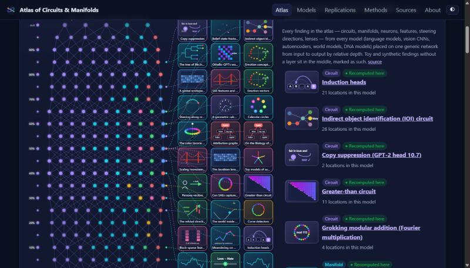
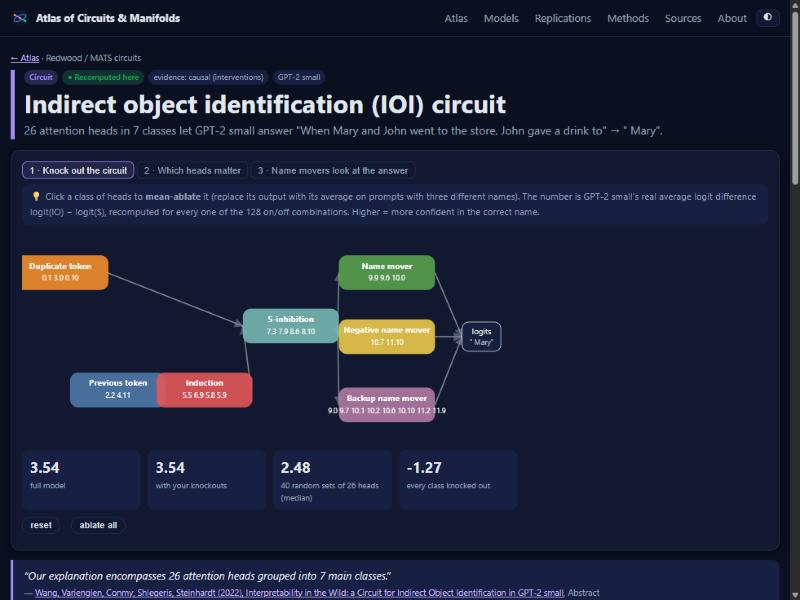
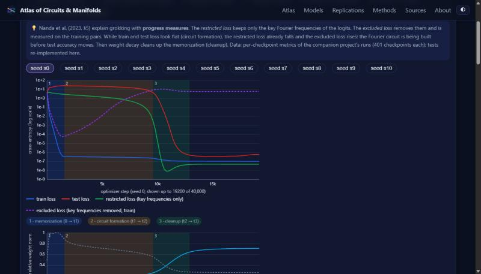
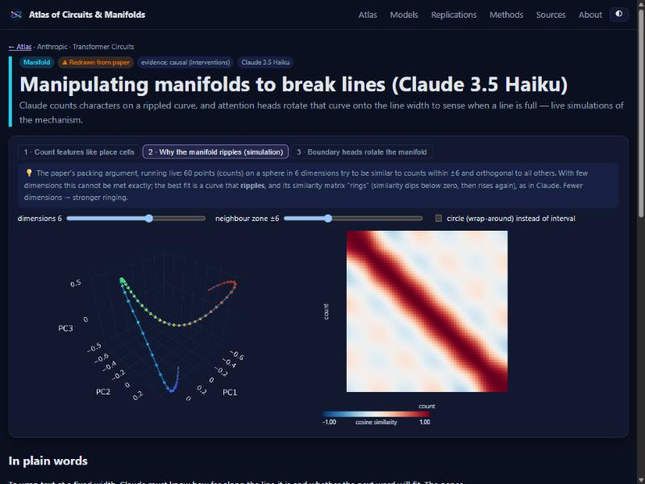
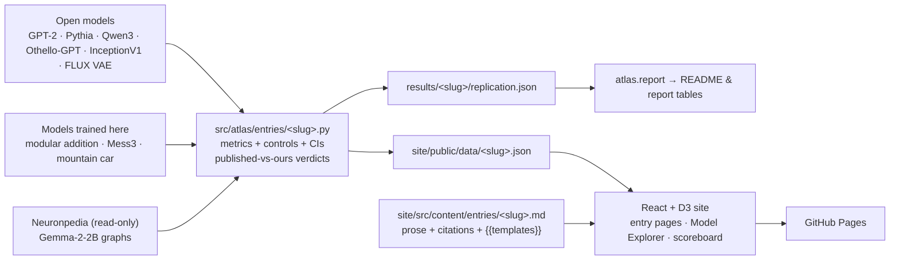

# Atlas of Circuits & Manifolds

**An interactive, cited field guide to the mechanisms found inside neural networks.** It covers attention-head
circuits, curved representation manifolds, interpretable neurons, sparse-autoencoder (SAE) features, steering vectors,
attribution graphs and lenses. Wherever an open model exists, the data is **recomputed on open models with our own
code**, and each recomputation is scored against criteria written down before it ran.

🌐 **Website:** https://burnycoder.github.io/circuits-and-manifolds-in-llms-atlas/ · **Author:** Libor "Burny" Burian ·
**Code:** MIT

- **In plain words.** Researchers keep finding small, readable "mechanisms" inside AI models. Two attention heads copy
  repeated text. Numbers sit on a spiral and get added like clock hands. Emotions form a map with "pleasant" on one
  axis and "excited" on the other. A single direction makes a chatbot refuse. This site collects the most interesting
  of these findings. It explains each one in plain language and in technical detail, shows where it lives inside the
  model, and lets you play with an interactive visualization. We also redo the experiments ourselves on public models
  and say honestly when a finding did not hold up.
- **For experts.** Each 🟢 entry re-tests a paper's central claims on open models (GPT-2, Pythia, Qwen3/Qwen2.5,
  TransformerLens toy models, Othello-GPT, InceptionV1, FLUX VAE, models trained here). The tests use matched controls
  (random heads/directions, shuffled labels, random-init models) and 95% bootstrap CIs. Each claim gets a pass /
  partial / fail verdict against a criterion fixed in [`reports/planned-runs.md`](reports/planned-runs.md) before the
  run. Closed-model findings (Claude, Evo 2) are 🟠 interactive redraws/simulations built from the published numbers,
  shown next to open-model replications by others. Everything is cited and deep-linked. Each entry has at most one
  verbatim quote of 15 words or fewer, and everything else is paraphrased.

**Motivation.** Interpretability results are scattered across blog posts, Distill articles, Transformer Circuits
papers, arXiv and LessWrong. Many have never been re-run outside the original lab, and many concern closed models.
Prior collections (e.g. [Neuronpedia](https://www.neuronpedia.org/),
[Transformer Circuits](https://transformer-circuits.pub/), the [ARENA](https://arena-chapter1-transformer-interp.streamlit.app/)
curriculum; see [`reports/state-of-the-art-review.md`](reports/state-of-the-art-review.md)) are either tool-centric or
single-lab. The atlas puts circuits *and* geometry in one place. It labels fidelity explicitly
(recomputed / replicated / redrawn) and reports replication verdicts, failures included.

**What is new here.**
1. One browsable map that places circuits, manifolds, neurons, features, steering vectors and lenses at their location
   inside clickable model diagrams (GPT-2, Qwen3, Othello-GPT, InceptionV1, Claude). Aggregate "General neural network"
   (every finding from every model on one input → output network), "General LLM" and "General transformer" views show
   where in relative depth each kind of mechanism tends to live.
2. Pre-registered-style replication checks of many classic results on open models, with controls and CIs, in one
   codebase where `python -m atlas.run --entries all` regenerates every number.
3. Small-model tests that the literature lacks. Examples: Fourier/helix probes for addition across Pythia sizes,
   counting manifolds in Qwen3-1.7B, emotion-vector geometry and steering in a 1.7B model, and Goodfire-style neuron
   sparsification on Qwen3.

| Model Explorer: every finding on one general neural network | IOI: toggle head classes, real recomputed logit differences |
|---|---|
|  |  |
| **Grokking: progress measures and the three training phases (11 seeds)** | **Linebreaks redraw: live simulation of the rippled counting manifold** |
|  |  |

## Results so far

Headline claim of each recomputed entry (regenerated by `uv run python -m atlas.report` from `results/`; see the
per-entry reports for every claim):

<!-- table:headlines -->
| Entry | Headline claim | Published | Ours | Verdict |
|---|---|---|---|---|
| attribution-graphs | Two-hop factual recall goes through an intermediate concept | Dallas → Texas → Austin path plus a direct shortcut (Claude 3.5 Haiku) | positive embedding → intermediate → answer path in 3/3 public Gemma-2-2B graphs (Dallas, Oakland, Shanghai) | ✅ pass |
| copy-suppression | L10H7's OV circuit suppresses the token it attends to | 84.70% of tokens: diagonal among 10 most negative; 98.86% in bottom 5% (column ranking) | 66.6% in top-10 most negative; 94.0% in bottom 5% (row ranking, 5000 tokens); other L10–11 heads: median 0.0% | ✅ pass |
| curve-detectors | Curve neurons are tuned to one orientation | each curve detector responds to curves in a narrow orientation band (radial tuning curves) | median orientation selectivity 0.95 vs 0.10 for 20 random mixed3b neurons | ✅ pass |
| greater-than | GPT-2 small predicts years greater than the start year | probability difference 81.7% | PD = 90.2% [89.7, 90.7] over 1164 prompts | ✅ pass |
| grokking | Generalization comes long after memorization (grokking) | train acc ~100% by ~1.4k epochs; test generalizes at ~10k (Fig. 2, wd=1, 30% split) | seed 0: train≥99% @ 200, test≥95% @ 7200; seed 1: train≥99% @ 200, test≥95% @ 6100; seed 2: train≥99% @ 200, test≥95% @ 13500 | ✅ pass |
| grokking-runs | Grokking replicates across seeds (companion project's 11 runs) | grokking with wd = 1 on a 30% split (Nanda et al. 2023, one run) | 11/11 seeds reach > 99% test accuracy; test-95% step ÷ train-99% step: median 57.2× (min 32.2×) | ✅ pass |
| induction-heads | A 2-layer attention-only model forms induction heads in layer 1 | Induction heads need ≥2 layers (Elhage et al. 2021); score defined by Olsson et al. 2022 | max layer-1 induction score 0.65 vs 0.033 at random init | ✅ pass |
| ioi | GPT-2 small prefers the indirect object over the subject | mean logit diff 3.56; IO > S in 99.3% of prompts | 3.54 [3.37, 3.70] on 320 prompts; IO > S in 99.4% | ✅ pass |
| othello-gpt | Othello-GPT predicts legal moves | illegal top-1 rate 0.01% (Li et al.) | 0.07% illegal top-1 moves on 500 held-out synthetic games | ✅ pass |
<!-- /table:headlines -->

Scoreboard of all pre-stated claims:

<!-- table:scoreboard -->
| Entry | Models | Claims | ✅ pass | 🟡 partial | ❌ fail | Runtime (s) | Generated (UTC) |
|---|---|---|---|---|---|---|---|
| [attribution-graphs](reports/experiments/attribution-graphs/experiment.md) | gemma-2-2b (Neuronpedia public graphs) | 2 | 2 | 0 | 0 | 88 | 2026-11-27 18:03 UTC |
| [copy-suppression](reports/experiments/copy-suppression/experiment.md) | gpt2 | 3 | 3 | 0 | 0 | 2 | 2026-11-27 17:49 UTC |
| [curve-detectors](reports/experiments/curve-detectors/experiment.md) | InceptionV1 (Lucid weights via Lucent) | 3 | 3 | 0 | 0 | 279 | 2026-11-27 18:30 UTC |
| [greater-than](reports/experiments/greater-than/experiment.md) | gpt2 | 3 | 3 | 0 | 0 | 98 | 2026-11-27 17:57 UTC |
| [grokking](reports/experiments/grokking/experiment.md) | 1L transformer (trained here) | 5 | 5 | 0 | 0 | 1585 | 2026-11-27 18:23 UTC |
| [grokking-runs](reports/experiments/grokking-runs/experiment.md) | BurnyCoder/grokking-modular-addition-runs | 5 | 5 | 0 | 0 | 131 | 2026-11-27 19:07 UTC |
| [induction-heads](reports/experiments/induction-heads/experiment.md) | attn-only-2l, gpt2, EleutherAI/pythia-160m | 4 | 4 | 0 | 0 | 1096 | 2026-11-27 17:47 UTC |
| [ioi](reports/experiments/ioi/experiment.md) | gpt2 | 5 | 5 | 0 | 0 | 120 | 2026-11-27 17:49 UTC |
| [othello-gpt](reports/experiments/othello-gpt/experiment.md) | othello-gpt | 3 | 3 | 0 | 0 | 133 | 2026-11-27 18:26 UTC |
| **Total (9 entries)** | | **33** | **33** | **0** | **0** | | |
<!-- /table:scoreboard -->

**In plainer language: where our numbers matched, beat or fell short of the papers.** Every recomputed claim so far
holds qualitatively, with matched controls behaving as the papers predict (random heads or directions do nothing,
shuffled labels and random-init models give chance). The quantitative differences are:

- **Close to the paper:** IOI's baseline logit difference and name-mover attention.
- **Stronger than the paper:** greater-than's probability difference and IOI faithfulness. Our prompts are simpler.
- **Weaker than the paper:** Othello-GPT board edits and the copy-suppression ablation. Copy suppression's direct
  effect replicates, but zero-ablation helps the copied token on only some prompts.

Batch 3–5 entries (geometry, Neural Geometry series, features, steering, lenses) are being run. Their rows appear here
once their full runs finish. Negative results will be listed explicitly.

## All entries

Data badges: 🟢 recomputed here · 🔵 open replication (by others, re-rendered) · 🟠 redrawn from a closed-model paper.

<!-- table:catalogue -->
| Entry | Category | Models | Data | Evidence |
|---|---|---|---|---|
| [Toy models of superposition (live)](https://burnycoder.github.io/circuits-and-manifolds-in-llms-atlas/#/entry/toy-superposition) | feature | toy ReLU autoencoder (in your browser) | 🟢 recomputed | causal |
| [Induction heads](https://burnycoder.github.io/circuits-and-manifolds-in-llms-atlas/#/entry/induction-heads) | circuit | attn-only-2l, GPT-2 small, Pythia-160M | 🟢 recomputed | mixed |
| [Indirect object identification (IOI) circuit](https://burnycoder.github.io/circuits-and-manifolds-in-llms-atlas/#/entry/ioi) | circuit | GPT-2 small | 🟢 recomputed | causal |
| [Copy suppression (GPT-2 head 10.7)](https://burnycoder.github.io/circuits-and-manifolds-in-llms-atlas/#/entry/copy-suppression) | circuit | GPT-2 small | 🟢 recomputed | causal |
| [Greater-than circuit](https://burnycoder.github.io/circuits-and-manifolds-in-llms-atlas/#/entry/greater-than) | circuit | GPT-2 small | 🟢 recomputed | causal |
| [Grokking modular addition (Fourier multiplication)](https://burnycoder.github.io/circuits-and-manifolds-in-llms-atlas/#/entry/grokking) | circuit | 1-layer transformer (trained here) | 🟢 recomputed | causal |
| [Othello-GPT's world model (mine vs. theirs)](https://burnycoder.github.io/circuits-and-manifolds-in-llms-atlas/#/entry/othello-gpt) | manifold | Othello-GPT | 🟢 recomputed | mixed |
| [Curve detectors (InceptionV1)](https://burnycoder.github.io/circuits-and-manifolds-in-llms-atlas/#/entry/curve-detectors) | neuron | InceptionV1 | 🟢 recomputed | correlational |
| [Calendar circles (days and months)](https://burnycoder.github.io/circuits-and-manifolds-in-llms-atlas/#/entry/calendar-circles) | manifold | GPT-2 small, Qwen3-1.7B | 🟢 recomputed | mixed |
| [The number helix (trigonometric addition)](https://burnycoder.github.io/circuits-and-manifolds-in-llms-atlas/#/entry/number-helix) | manifold | Pythia-160M, Pythia-410M, Pythia-1B, Pythia-1.4B, Pythia-2.8B | 🟢 recomputed | mixed |
| [The character-counting manifold (line breaking)](https://burnycoder.github.io/circuits-and-manifolds-in-llms-atlas/#/entry/linebreak-manifold) | manifold | Qwen3-1.7B, GPT-2 small | 🔵 open replication | correlational |
| [Manipulating manifolds to break lines (Claude 3.5 Haiku)](https://burnycoder.github.io/circuits-and-manifolds-in-llms-atlas/#/entry/linebreaks-claude) | manifold | Claude 3.5 Haiku | 🟠 redrawn | causal |
| [Belief-state fractals in the residual stream](https://burnycoder.github.io/circuits-and-manifolds-in-llms-atlas/#/entry/belief-fractal) | manifold | 4-layer transformer (trained here) | 🟢 recomputed | correlational |
| [The color bicone in an image autoencoder](https://burnycoder.github.io/circuits-and-manifolds-in-llms-atlas/#/entry/colour-bicone) | manifold | FLUX VAE | 🟢 recomputed | correlational |
| [Attribution graphs (the "biology" of an LLM, on Gemma-2-2B)](https://burnycoder.github.io/circuits-and-manifolds-in-llms-atlas/#/entry/attribution-graphs) | attribution | Gemma-2-2B | 🔵 open replication | mixed |
| [On the Biology of a Large Language Model (Claude 3.5 Haiku)](https://burnycoder.github.io/circuits-and-manifolds-in-llms-atlas/#/entry/biology-claude) | attribution | Claude 3.5 Haiku | 🟠 redrawn | causal |
| [SAE features and "Golden Gate" steering (GPT-2)](https://burnycoder.github.io/circuits-and-manifolds-in-llms-atlas/#/entry/sae-features) | feature | GPT-2 small | 🟢 recomputed | causal |
| [Scaling monosemanticity and Golden Gate Claude (Claude 3 Sonnet)](https://burnycoder.github.io/circuits-and-manifolds-in-llms-atlas/#/entry/scaling-monosemanticity-claude) | feature | Claude 3 Sonnet | 🟠 redrawn | causal |
| [Neurons as an interpretable basis (and "already clean")](https://burnycoder.github.io/circuits-and-manifolds-in-llms-atlas/#/entry/neuron-basis) | neuron | Qwen3-1.7B | 🟢 recomputed | causal |
| [The refusal direction](https://burnycoder.github.io/circuits-and-manifolds-in-llms-atlas/#/entry/refusal-direction) | steering | Qwen2.5-1.5B-Instruct | 🟢 recomputed | causal |
| [Activation addition (steering vectors)](https://burnycoder.github.io/circuits-and-manifolds-in-llms-atlas/#/entry/actadd) | steering | GPT-2-XL | 🟢 recomputed | causal |
| [Emotion vectors (open model)](https://burnycoder.github.io/circuits-and-manifolds-in-llms-atlas/#/entry/emotions) | steering | Qwen3-1.7B | 🔵 open replication | mixed |
| [Emotion concepts and their function (Claude Sonnet 4.5)](https://burnycoder.github.io/circuits-and-manifolds-in-llms-atlas/#/entry/emotions-claude) | steering | Claude Sonnet 4.5 | 🟠 redrawn | causal |
| [Persona vectors](https://burnycoder.github.io/circuits-and-manifolds-in-llms-atlas/#/entry/persona-vectors-claude) | steering | Qwen2.5-7B-Instruct, Llama-3.1-8B-Instruct | 🟠 redrawn | causal |
| [The Jacobian lens and the global workspace (open model)](https://burnycoder.github.io/circuits-and-manifolds-in-llms-atlas/#/entry/jlens) | lens | Qwen3-1.7B | 🔵 open replication | mixed |
| [A global workspace in Claude (J-space)](https://burnycoder.github.io/circuits-and-manifolds-in-llms-atlas/#/entry/global-workspace-claude) | lens | Claude Sonnet 4.5, Claude Haiku 4.5, Claude Opus 4.5 | 🟠 redrawn | causal |
| [The world inside a world model (mountain car)](https://burnycoder.github.io/circuits-and-manifolds-in-llms-atlas/#/entry/world-model) | manifold | mountain-car world model (trained here) | 🟢 recomputed | mixed |
| [Can SAEs capture neural geometry?](https://burnycoder.github.io/circuits-and-manifolds-in-llms-atlas/#/entry/sae-manifolds) | feature | TopK SAEs on synthetic manifolds (trained here) | 🟢 recomputed | correlational |
| [Block-sparse featurizers (multi-dimensional concepts)](https://burnycoder.github.io/circuits-and-manifolds-in-llms-atlas/#/entry/block-sparse-featurizers) | feature | BSF / TopK SAE (trained here), InceptionV1 | 🟢 recomputed | correlational |
| [Steering along manifolds](https://burnycoder.github.io/circuits-and-manifolds-in-llms-atlas/#/entry/manifold-steering) | manifold | Qwen3-1.7B | 🟢 recomputed | causal |
| [A geometric calculator (base-10 circles)](https://burnycoder.github.io/circuits-and-manifolds-in-llms-atlas/#/entry/geometric-calculator) | circuit | Llama-3.1-8B (paper), Pythia-410M/1.4B/2.8B (our probes) | 🔵 open replication | causal |
| [Meandering on manifolds (stories in emotion space)](https://burnycoder.github.io/circuits-and-manifolds-in-llms-atlas/#/entry/stories-in-space) | manifold | Qwen2.5-1.5B-Instruct | 🟢 recomputed | correlational |
| [The tree of life inside a DNA model (Evo 2)](https://burnycoder.github.io/circuits-and-manifolds-in-llms-atlas/#/entry/phylogeny-manifold) | manifold | Evo 2 | 🟠 redrawn | correlational |
<!-- /table:catalogue -->

## How it works



When you run `uv run python -m atlas.run --entries all`:

1. `.env` is loaded, so Hugging Face/torch caches go to the configured disk. The device (CUDA if available) is chosen.
2. For each entry module in order, the runner does the following. It logs everything to `logs/<timestamp>_run_*.log`,
   continues past a failing entry, and frees GPU memory between entries.
   - It downloads or loads the model (GPT-2 via TransformerLens, Pythia/Qwen via transformers, InceptionV1 via Lucent,
     or trains the small models).
   - It builds the dataset: synthetic prompts in the paper's style, random-token sequences, synthetic Othello games,
     curve images, stories, or public datasets.
   - It computes the paper's metric and its controls.
   - It writes `site/public/data/<slug>.json` (visualization payload + summary + verdict rows) and
     `results/<slug>/{metrics,replication}.json`.
3. `uv run python -m atlas.report` rewrites the tables in this README and in `reports/experiments/` from `results/`.
4. The site reads the JSON files at page load. The Markdown pages fill `{{templates}}` from the same summaries, so the
   website, README and reports always show the same numbers.

More detail is in [`docs/architecture.md`](docs/architecture.md),
[`docs/replication-protocol.md`](docs/replication-protocol.md) and [`docs/adding-an-entry.md`](docs/adding-an-entry.md).

## Methods (with sources)

| Method | Used for | Source |
|---|---|---|
| Activation patching / noising, mean-ablation | IOI, greater-than, induction | [Wang et al. 2022](https://arxiv.org/abs/2211.00593), [Hanna et al. 2023](https://arxiv.org/abs/2305.00586), [Heimersheim & Nanda 2024](https://arxiv.org/abs/2404.15255) |
| Direct logit attribution, OV/QK circuit analysis | IOI, copy suppression | [Elhage et al. 2021](https://transformer-circuits.pub/2021/framework/index.html), [McDougall et al. 2023](https://arxiv.org/abs/2310.04625) |
| Induction / prefix-matching scores | induction heads | [Olsson et al. 2022](https://transformer-circuits.pub/2022/in-context-learning-and-induction-heads/index.html) |
| Fourier analysis of modular arithmetic | grokking | [Nanda et al. 2023](https://arxiv.org/abs/2301.05217) |
| Linear probes + probe-direction interventions | Othello-GPT, counting, world model | [Li et al. 2023](https://arxiv.org/abs/2210.13382), [Nanda, Lee, Wattenberg 2023](https://arxiv.org/abs/2309.00941) |
| Synthetic-stimulus tuning curves, feature visualization | curve detectors | [Cammarata et al. 2020](https://distill.pub/2020/circuits/curve-detectors/), [Lucent](https://github.com/greentfrapp/lucent) |
| Circular / helical representations | calendar circles, number helix | [Engels et al. 2024](https://arxiv.org/abs/2405.14860), [Kantamneni & Tegmark 2025](https://arxiv.org/abs/2502.00873) |
| Attribution graphs (transcoders, circuit-tracer) | attribution graphs | [Ameisen et al. 2025](https://transformer-circuits.pub/2025/attribution-graphs/methods.html), [circuit-tracer](https://github.com/safety-research/circuit-tracer) |
| Difference-of-means directions, directional ablation, activation addition | refusal, emotions, ActAdd | [Arditi et al. 2024](https://arxiv.org/abs/2406.11717), [Turner et al. 2023](https://arxiv.org/abs/2308.10248) |
| Sparse autoencoders | SAE features, SAE manifolds | [Bloom 2024 (GPT-2 res-jb)](https://www.lesswrong.com/posts/f9EgfLSurAiqRJySD/open-source-sparse-autoencoders-for-all-residual-stream), [SAELens](https://github.com/jbloomAus/SAELens) |
| Jacobian lens | J-lens | [Gurnee et al. 2026](https://transformer-circuits.pub/2026/workspace/index.html) |

The literature reviews ([`reports/literature-review.md`](reports/literature-review.md),
[`reports/state-of-the-art-review.md`](reports/state-of-the-art-review.md)) list every source with links.

## Features

- **Atlas grid** with filters by category, model, evidence type, data fidelity and collection (Anthropic Transformer
  Circuits, Goodfire Neural Geometry, Distill Circuits, Tegmark lab, …).
- **Entry pages** include:
  - a layman and an expert explanation, with KaTeX math;
  - an interactive visualization with controls and a "how to read this" note;
  - key numbers templated from our data;
  - at most one short quote;
  - replications by others (✓ / partial / ✗);
  - our verdict table;
  - limitations, citations with deep links, and related entries.
- **Model Explorer:** animated, clickable architecture diagrams. Hovering a GPT-2 head shows its measured
  induction / previous-token / duplicate-token scores and real attention patterns. Findings appear as small schematic
  thumbnails pinned to their layers and expand into the full visualization. The aggregate *General neural network* view
  (the default) puts every finding of every model on one generic input → output network, with rows colored by the mix
  of finding types at each depth. *General LLM* and *General transformer* map findings onto a generic transformer.
- **Replications scoreboard** across all entries; **Methods** glossary; **Sources** list.
- **Closed-model redraws:**
  - Biology of an LLM (8 case studies);
  - the linebreak-counting manifold, with a live particle simulation and QK-rotation demo;
  - Scaling Monosemanticity / Golden Gate;
  - emotion concepts (blackmail and reward-hacking steering sliders);
  - the global workspace (J-space);
  - persona vectors;
  - the Evo 2 phylogeny manifold.

## Technologies

Python 3.12 with [uv](https://docs.astral.sh/uv/) · PyTorch 2.11 (CUDA 12.8) ·
[TransformerLens](https://github.com/TransformerLensOrg/TransformerLens) 3.9 ·
[SAELens](https://github.com/jbloomAus/SAELens) 6 · Hugging Face transformers 5 / diffusers ·
[circuit-tracer](https://github.com/safety-research/circuit-tracer) · [Lucent](https://github.com/greentfrapp/lucent) ·
gymnasium · NumPy / scikit-learn. Site: Vite 8 · React 19 · TypeScript · D3 7 · Plotly · KaTeX · marked · Vitest ·
GitHub Actions → GitHub Pages.

## Install and use

Requirements: an NVIDIA GPU with ≥ 8 GB VRAM for the full pipeline (most entries also run on CPU with `--quick`),
[uv](https://docs.astral.sh/uv/getting-started/installation/), Node.js ≥ 22, Git. About 25 GB of disk for model caches.

```bash
git clone https://github.com/BurnyCoder/circuits-and-manifolds-in-llms-atlas
cd circuits-and-manifolds-in-llms-atlas
cp .env.example .env        # set HF_HOME / TORCH_HOME to a disk with space; NEURONPEDIA_API_KEY is optional
uv sync --extra graphs      # creates .venv with Python 3.12 and CUDA torch
uv run pytest               # synthetic ground-truth tests (Fourier, geometry, Othello rules, belief states)

# Recompute entries (smoke test first, then full):
uv run python -m atlas.run --entries induction_heads,ioi --quick
uv run python -m atlas.run --entries all             # full pipeline; several hours on a laptop GPU
uv run python -m atlas.report                        # refresh README / report tables from results/

# Website
cd site
npm ci
npm run dev                 # http://localhost:5173
npm test                    # content checks: citations, quotes, data files, templates
npm run build               # static build in site/dist
```

Entry module names are listed in `ENTRIES` in [`src/atlas/run.py`](src/atlas/run.py). Logs go to `logs/`, raw
results to `results/`, site data to `site/public/data/`.

## Repository layout

| Path | What |
|---|---|
| `src/atlas/run.py` | single entry point; runs entry modules in order |
| `src/atlas/entries/` | one module per recomputed entry (`compute(ctx)`) |
| `src/atlas/common/` | env/device, JSON export, logging, bootstrap CIs, geometry, Fourier, attention scores, Othello engine |
| `src/atlas/report.py` | regenerates all results tables from `results/` |
| `site/` | Vite + React + TypeScript website; entries are Markdown in `site/src/content/entries/`, visualizations in `site/src/viz/` |
| `results/` | raw metrics and replication verdicts per entry (JSON) |
| `reports/` | plan, planned runs (pre-stated criteria), literature/SoTA reviews, experiments, progress, reviews |
| `docs/` | architecture, replication protocol, how to add an entry |
| `tests/`, `site/tests/` | pytest (synthetic ground truth) and Vitest (content integrity) |

## To do

- [ ] Finish full runs of batches 3–5, then write their experiment reports and update this README.
- [ ] Upload models trained here (modular addition ×3 seeds, Mess3 belief transformer, mountain-car world model) to one
      Hugging Face collection.
- [ ] Paper-scale runs on a rented GPU (≤ $20): number helix on GPT-J/Pythia-6.9B, geometric calculator and manifold
      steering on an 8B model, emotions/J-lens at 8B.
- [ ] Fact-check and link-check every citation; NeurIPS-style self-review into `reports/reviews/`.
- [ ] Screenshots and a short screen recording for this README.
- [ ] Stretch entries: assistant axis, successor heads, function vectors, attention sinks, entropy neurons, truth
      directions, feature absorption, crosscoders.

## License and attribution

Code: MIT ([LICENSE](LICENSE)). Text is our own paraphrase with links to the sources. Quotes are short (≤ 15 words) and
attributed. Figures from closed-model papers are redrawn from published numbers, not copied. Public Neuronpedia graphs
are fetched read-only and re-rendered with attribution.
