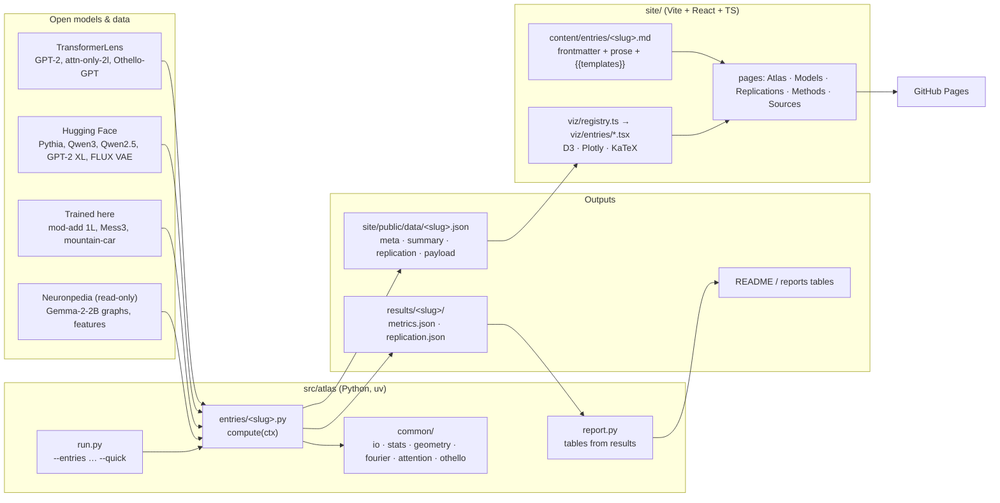

# Architecture

The atlas has two halves that meet in JSON files: a Python pipeline that recomputes findings on open models, and a
static React site that renders them.

## Python pipeline

- **`src/atlas/run.py`**: the single entry point. It loads `.env` before importing torch or transformers (cache paths),
  picks the device, then imports and runs each requested entry module lazily, so one entry's heavy dependencies
  (diffusers, gymnasium, SAELens) never load for another. It keeps going past a failing entry and logs the traceback.
  It frees CUDA memory between entries.
- **`src/atlas/entries/<module>.py`**: one module per entry with `compute(ctx)`. Each loads its model and data,
  computes the metrics and their controls, builds the visualization payload, and calls `common.io.write_entry`.
  `ctx.quick` shrinks sample sizes for smoke tests.
- **`src/atlas/common/`**: shared helpers.
  - `io.py`: compact JSON export and the published-vs-ours `verdict_row`.
  - `stats.py`: bootstrap confidence intervals.
  - `geometry.py`: PCA, cyclic-order tests, ridge probes.
  - `fourier.py`: Fourier basis for modular arithmetic.
  - `attention.py`: head scores.
  - `othello.py`: game engine.
  - `models.py`: cached TransformerLens loaders.
  - `log.py`: timestamped logging to `logs/`.
- **`src/atlas/report.py`**: rewrites every results table between `<!-- table:NAME -->` markers in README.md and
  `reports/experiments/**` from `results/*/replication.json`. No result number is typed by hand.

## Website

- **Content:** each entry is `site/src/content/entries/<slug>.md`. Its YAML frontmatter (`EntryMeta` in
  `site/src/lib/types.ts`) holds:
  - category, collection and models;
  - fidelity (recomputed / replicated / redrawn) and evidence type;
  - `viz` key and `data` file;
  - citations, replications by others, at most one ≤15-word quote, and the locations inside models for the explorer.

  The body is Markdown with KaTeX math and `{{key}}` / `{{key|pct}}` templates that resolve against the data file's
  `summary`.
- **Visualizations:** `site/src/viz/registry.ts` maps `viz` keys to lazily loaded React components in
  `site/src/viz/entries/`. They are built from primitives in `site/src/viz/primitives/` (heatmap, line chart, bars,
  token attention, 2-D scatter, Plotly 3-D).
- **Model Explorer:** `site/src/components/ModelExplorer.tsx` draws each model's architecture from `site/src/lib/models.ts`
  and highlights the components named in entries' `locations`. Small schematic thumbnails (`site/src/viz/thumbs.tsx`)
  expand into the entry's full visualization. The "General LLM" and "General transformer" views map findings to
  relative depth on a generic transformer. "General neural network" maps every finding of every model onto one
  generic input → 20 hidden layers → output network. CNN and pipeline stages map to depth by stage index; entries
  without a location get a labelled mid-depth pin. Its rows are colored by the mix of finding categories at that depth.
- **Tests:** `site/tests/content.test.ts` checks that:
  - every entry has the required fields and citation URLs;
  - quotes are ≤15 words and cite a listed source;
  - `viz` keys are registered;
  - data files exist and every template resolves.
- **Deployment:** `.github/workflows/pages.yml` runs `npm ci → npm test → npm run build` and deploys to GitHub Pages.
